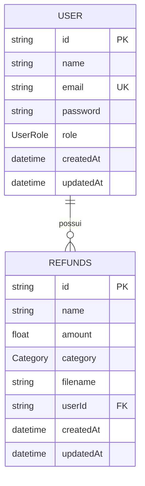

# 💸 Refund API - Sistema de Solicitacões de Reembolso

[](https://www.typescriptlang.org/)
[](https://nodejs.org/)
[](https://expressjs.com/)
[](https://www.prisma.io/)
[](https://www.sqlite.org/)
[](https://opensource.org/licenses/ISC)

> API RESTful robusta desenvolvida em **Node.js** com **TypeScript** e **Prisma ORM** para a gestão e solicitação de reembolsos de despesas corporativas com suporte a múltiplos perfis de acesso (**RBAC**) e upload de comprovantes.

---

## 📌 Índice

- [Sobre o Projeto](#-sobre-o-projeto)
- [✨ Funcionalidades](#-funcionalidades)
- [🛠️ Tecnologias Utilizadas](#️-tecnologias-utilizadas)
- [🧱 Estrutura da Aplicação](#-estrutura-da-aplicação)
- [🗄️ Modelo de Dados](#️-modelo-de-dados)
- [🚨 Controle de Acesso (RBAC)](#-controle-de-acesso-rbac)
- [🔌 Endpoints da API](#-endpoints-da-api)
- [🚀 Como Executar o Projeto](#-como-executar-o-projeto)
- [📄 Licença](#-licença)

---

## 📖 Sobre o Projeto

O **Refund API** é uma solução backend desenvolvida para simplificar o fluxo de reembolso de despesas operacionais em empresas. A aplicação permite que funcionários enviem comprovantes e registrem solicitações de reembolso categorizadas (alimentação, hospedagem, transporte, serviços, etc.), enquanto gestores têm acesso para visualizar e auditar as solicitações realizadas.

O projeto foi construído seguindo princípios de **Clean Code**, **Arquitetura em Camadas** (Controllers, Services/Middlewares, Routes, Configs) e forte tipagem com **TypeScript**.

---

## ✨ Funcionalidades

- 🔒 **Autenticação & Segurança**:
  - Cadastro de usuários com criptografia de senha (`bcrypt`).
  - Autenticação via JSON Web Tokens (`JWT`).
  - Proteção de rotas privadas via middleware de autenticação.

- 🛡️ **Controle de Acesso Baseado em Funções (RBAC)**:
  - **Funcionário (`employee`)**: Envia comprovantes físicos/digitais e cria solicitações de reembolso.
  - **Gestor (`manager`)**: Visualiza todas as solicitações corporativas registradas e acessa detalhes individuais.

- 🧾 **Gestão de Reembolsos**:
  - Cadastro de despesas associadas a categorias predefinidas (`food`, `accommodation`, `transport`, `services`, `others`).
  - Armazenamento e vinculação de comprovantes anexados.
  - Consulta de detalhes da solicitação.

- 📁 **Upload de Arquivos**:
  - Manipulação e upload seguro de comprovantes via `Multer`.
  - Servidor estático para acesso aos comprovantes gravados.

- ✅ **Validação & Tratamento de Erros**:
  - Validação rigorosa dos dados de entrada utilizando **Zod**.
  - Handler global de erros customizados (`AppError`) desacoplado da camada de transporte.

---

## 🛠️ Tecnologias Utilizadas

- **Linguagem**: [TypeScript](https://www.typescriptlang.org/)
- **Runtime**: [Node.js](https://nodejs.org/)
- **Framework Web**: [Express.js](https://expressjs.com/)
- **ORM & Banco de Dados**: [Prisma ORM](https://www.prisma.io/) com [SQLite](https://www.sqlite.org/) (ou PostgreSQL)
- **Validação de Schemas**: [Zod](https://zod.dev/)
- **Autenticação**: [JSON Web Token (JWT)](https://jwt.io/) & [bcrypt](https://github.com/kelektiv/node.bcrypt.js)
- **Upload de Arquivos**: [Multer](https://github.com/expressjs/multer)
- **Execução em Dev**: [tsx](https://github.com/privatenumber/tsx) (TypeScript Execute)

---

## 🧱 Estrutura da Aplicação

```text
refund_api/
├── prisma/
│   ├── dev.db              # Banco de dados SQLite local
│   ├── migrations/         # Migrações do banco de dados
│   └── schema.prisma       # Definição das tabelas e enums
├── src/
│   ├── configs/            # Configurações de JWT, Upload, etc.
│   │   ├── auth.ts
│   │   └── upload.ts
│   ├── controllers/        # Controladores das requisições HTTP
│   ├── database/           # Instância e cliente do Prisma
│   ├── middlewares/        # Middlewares de Auth, RBAC e Tratamento de Erros
│   ├── providers/          # Provedores de serviços auxiliares
│   ├── routes/             # Definição das rotas e agrupamento
│   ├── types/              # Definições de tipos TypeScript
│   ├── utils/              # Classes utilitárias (ex: AppError)
│   ├── app.ts              # Setup do servidor Express
│   └── server.ts           # Inicialização e escuta da porta
├── uploads/                # Diretório físico para arquivos salvos
├── package.json
└── tsconfig.json
```

---

## 🗄️ Modelo de Dados

### Enums

- **UserRole**: `employee` | `manager`
- **Category**: `food` | `accommodation` | `transport` | `services` | `others`

### Entidades



---

## 🚨 Controle de Acesso (RBAC)

| Perfil (`role`) | Cadastrar Usuário / Autenticar | Enviar Comprovante | Criar Reembolso | Listar Todos os Reembolsos | Visualizar Reembolso Específico |
| :--- | :---: | :---: | :---: | :---: | :---: |
| **Público** | ✅ | ❌ | ❌ | ❌ | ❌ |
| **Funcionário (`employee`)** | ✅ | ✅ | ✅ | ❌ | ✅ |
| **Gestor (`manager`)** | ✅ | ❌ | ❌ | ✅ | ✅ |

---

## 🔌 Endpoints da API

### Autenticação & Usuários (Público)

| Método | Rota | Descrição |
| :--- | :--- | :--- |
| `POST` | `/users` | Cadastra um novo usuário no sistema |
| `POST` | `/sessions` | Autentica um usuário e retorna o Token JWT |

### Uploads (Requer Autenticação - `employee`)

| Método | Rota | Descrição |
| :--- | :--- | :--- |
| `POST` | `/uploads` | Realiza o upload do arquivo de comprovante (`multipart/form-data`) |

### Reembolsos (Requer Autenticação)

| Método | Rota | Autorização | Descrição |
| :--- | :--- | :--- | :--- |
| `POST` | `/refunds` | `employee` | Registra uma nova solicitação de reembolso |
| `GET` | `/refunds` | `manager` | Lista todas as solicitações de reembolso |
| `GET` | `/refunds/:id` | `employee`, `manager` | Detalhes de uma solicitação específica pelo ID |

---

## 🚀 Como Executar o Projeto

### Pré-requisitos

Antes de começar, garante que você possui o [Node.js](https://nodejs.org/) (v18+) e o [Git](https://git-scm.com/) instalados em sua máquina.

### Passo a Passo

1. **Clonar o repositório:**
   ```bash
   git clone https://github.com/KevinLopes23/refund_api.git
   cd refund_api
   ```

2. **Instalar as dependências:**
   ```bash
   npm install
   ```

3. **Executar as Migrações do Banco de Dados (Prisma):**
   ```bash
   npx prisma migrate dev
   ```

4. **Iniciar o Servidor de Desenvolvimento:**
   ```bash
   npm run dev
   ```

5. O servidor estará rodando em `http://localhost:3333` (ou porta configurada).

---

## 📄 Licença

Este projeto está sob a licença [ISC](https://opensource.org/licenses/ISC).

---

Feito com 💜 por [Kevin Lopes](https://github.com/KevinLopes23)
