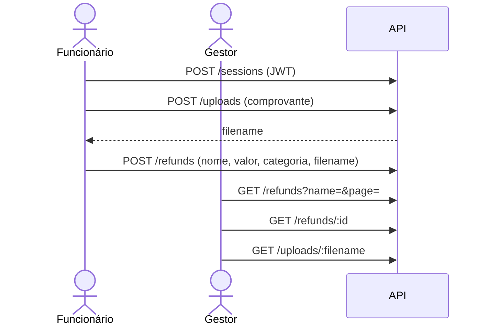
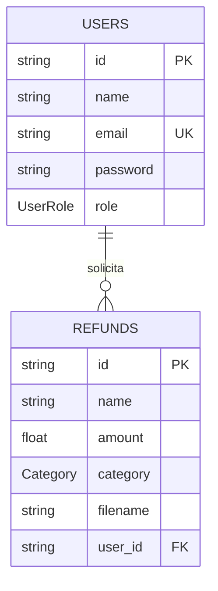

<div align="center">

# 💸 Refund API

**API REST para solicitações de reembolso de despesas corporativas, com upload de comprovantes e acesso por perfil.**


</div>

---

## 💡 Sobre

O Refund API simplifica o fluxo de reembolso em empresas: o funcionário envia a foto do comprovante e registra a despesa em uma categoria; o gestor lista, pesquisa e audita todas as solicitações. Projeto prático desenvolvido durante a formação Node.js da Rocketseat.

## ✨ Funcionalidades

- 🔐 Cadastro com senha criptografada (bcrypt) e login com JWT
- 🛡️ Controle de acesso por perfil (`employee` / `manager`)
- 📎 Upload de comprovantes (JPEG/PNG) via Multer, servidos estaticamente em `/uploads`
- 🧾 Solicitações de reembolso por categoria: `food`, `accommodation`, `transport`, `services`, `others`
- 🔎 Listagem paginada com busca por nome (`?name=&page=&perPage=`)
- ✅ Validação com Zod e tratamento global de erros (`AppError`)

## 🛠️ Tecnologias

Node.js · TypeScript · Express · Prisma ORM · SQLite · JWT · bcrypt · Multer · Zod · tsx

## 🔄 Fluxo



## 📌 Endpoints

Rotas privadas exigem `Authorization: Bearer <token>`.

| Método | Rota | Acesso | Descrição |
|---|---|---|---|
| `POST` | `/users` | Público | Cadastra um usuário |
| `POST` | `/sessions` | Público | Autentica e retorna o token JWT |
| `POST` | `/uploads` | `employee` | Envia o comprovante (`multipart/form-data`, campo `file`) |
| `POST` | `/refunds` | `employee` | Cria uma solicitação de reembolso |
| `GET` | `/refunds` | `manager` | Lista solicitações com busca e paginação |
| `GET` | `/refunds/:id` | `employee`, `manager` | Detalha uma solicitação |
| `GET` | `/uploads/:filename` | Público | Arquivo do comprovante (estático) |

## 🗄️ Banco de dados

SQLite (`prisma/dev.db`) com Prisma:



## 🚀 Como rodar

Pré-requisitos: Node.js 18+ e npm.

```bash
# 1. Instalar dependências
npm install

# 2. Criar/atualizar o banco SQLite
npx prisma migrate dev

# 3. Subir a API
npm run dev
```

A API sobe em `http://localhost:3333`. Não há variáveis de ambiente — o banco e as configurações de JWT ficam em `prisma/schema.prisma` e `src/configs/auth.ts`.

> ⚠️ A chave do JWT está fixa no código para fins de estudo. Em produção, mova-a para uma variável de ambiente.

## 👤 Autor

Feito por [Kevin Lopes](https://github.com/KevinLopes23)
